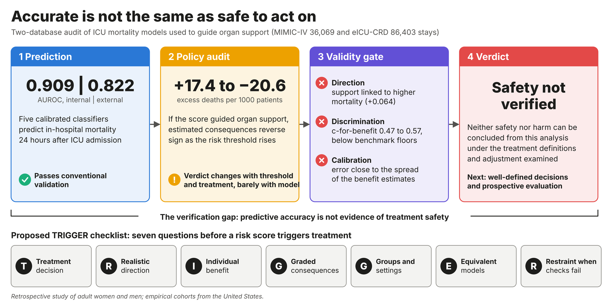
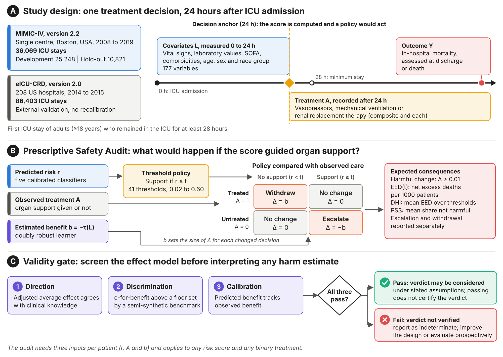
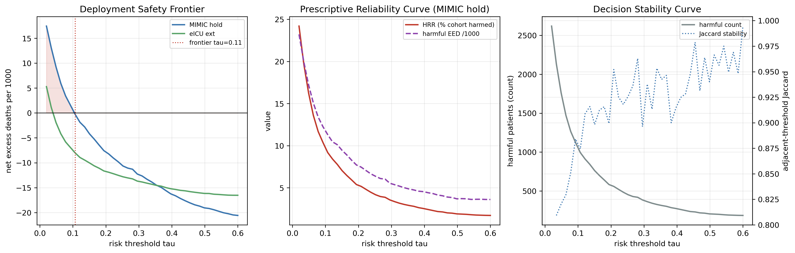
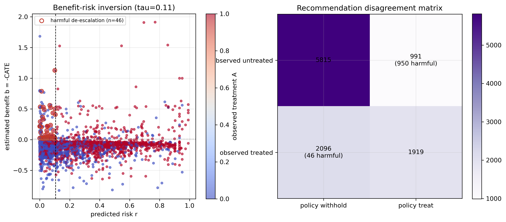
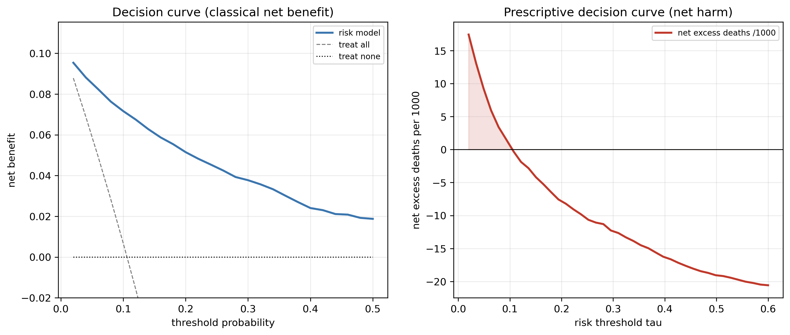
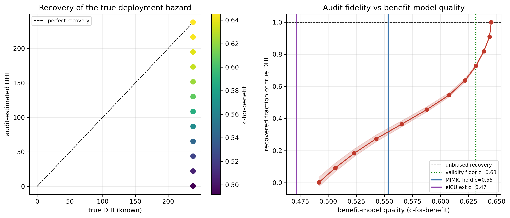
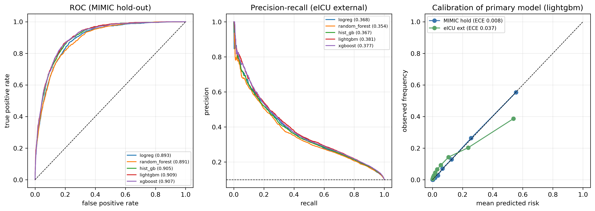
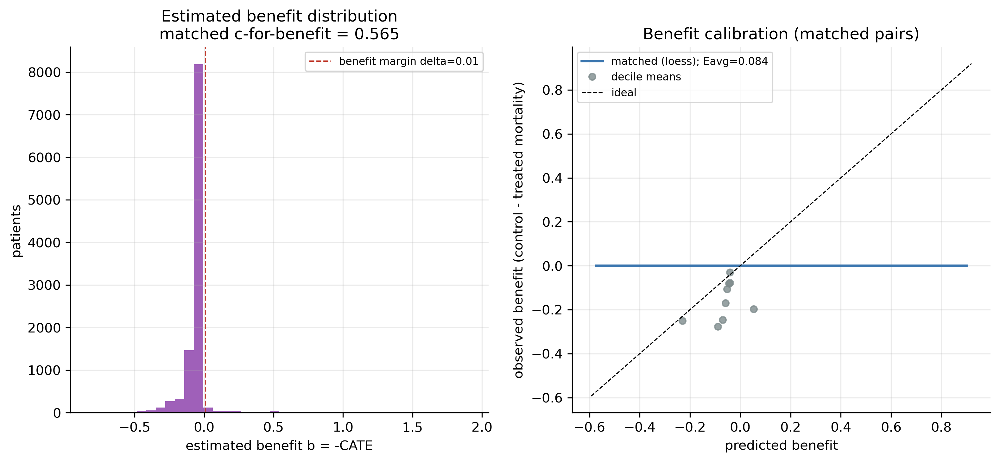

<div align="center">

# Accurate but Unverified

### Can an accurate ICU mortality model safely decide who gets organ support?

**A reproducible audit that turns a risk score into its expected consequences for patients, and tells you when those consequences cannot be trusted.**

[](../../actions/workflows/tests.yml)




</div>

---

## The problem in one paragraph

Mortality models for intensive care are usually judged by discrimination and calibration. But once a score is used to **escalate or withdraw treatment**, its safety depends on what happens when care changes, and accuracy cannot tell you that. A model learns risk under the care patients actually received, so a patient can look low risk *because* treatment is protecting them. Withdraw that treatment on the strength of the score and the model's accuracy becomes the mechanism of harm. We call the distance between "this model predicts well" and "acting on it is safe" the **verification gap**.

This repository measures that gap on **122,472 ICU stays** from two databases, with five models, a doubly robust treatment-effect learner, and an audit you can reuse with any risk score and any binary treatment.

## Headline results

| Layer | What we found | Number |
|---|---|---|
| **Prediction** | All five models discriminate and calibrate well | AUROC **0.909** internal, **0.822** external (LightGBM) |
| **Models compared** | Audit results barely differ between models | PSS 0.813 to 0.832; DHI −10.95 to −10.11 per 1000 |
| **Policy audit** | Estimated consequences reverse sign as the threshold rises | **+17.4 → −20.6** net excess deaths per 1000 |
| **By treatment** | Verdicts disagree across therapies | DHI −7.18 (ventilation) to **+53.29** (renal replacement) |
| **Effect direction** | Adjusted estimates say organ support *raises* mortality (implausible) | AIPW risk difference **+0.064** |
| **Benefit ranking** | Individual benefit estimates rank patients close to chance | c-for-benefit **0.47 to 0.57** |
| **Verdict** | Screening checks fail | **Safety not verified**, and harm not shown either |

> The negative Deployment Hazard Index in this analysis is **not** evidence that withdrawing organ support helps patients. It mirrors effect estimates that failed every screening check. The point of the audit is to make that visible before anyone acts on the number.

## How the audit works



For a threshold `t`, the policy "treat if predicted risk ≥ t" is compared with the care each patient actually received:

| Observed care | Policy says | Change in expected risk Δ |
|---|---|---|
| Treated | do not treat (r < t) | **withdraw:** Δ = b |
| Untreated | treat (r ≥ t) | **escalate:** Δ = −b |
| otherwise | agrees | 0 |

`b` is the estimated individual benefit (minus the conditional average treatment effect). Summing Δ gives **expected excess deaths per 1000 patients at every threshold**, split into escalation and withdrawal. A **validity gate** of three screening checks (direction, discrimination, calibration) decides whether that verdict may be considered at all. Full definitions: [`docs/METHODS.md`](docs/METHODS.md).

## Use the audit on your own model in five lines

The audit needs three arrays per patient and nothing else. A lightweight implementation that mirrors the notebook definitions is in [`psa/`](psa/audit.py).

```python
from psa import sweep, summarise, rank_concordance

# r: predicted risk, a: observed treatment (0/1), b: estimated benefit (-CATE) from any effect model
results = sweep(r, a, b)                   # primary output: metrics at every threshold
print(summarise(results))                  # DHI, PSS and the escalation/withdrawal split
print(rank_concordance(r, b))              # < 0.5 means risk and benefit are inversely ranked
```

No clinical data? Run the simulated example, which reproduces the benchmark's behaviour:

```bash
python examples/synthetic_demo.py
```

```
true benefit: DHI   240.8 per 1000 | withdraw   265.8 | escalate  -24.9 | PSS 0.284 | c-for-benefit 0.644
  half noise: DHI   115.6 per 1000 | withdraw   128.2 | escalate  -12.7 | PSS 0.336 | c-for-benefit 0.608
  pure noise: DHI    -9.7 per 1000 | withdraw    -9.3 | escalate   -0.4 | PSS 0.515 | c-for-benefit 0.509
```

The audit fades towards zero as benefit estimates degrade, while the c-for-benefit moves only from about 0.51 to 0.64. A reassuring or flat audit can therefore reflect a weak benefit model rather than a safe policy.

## The TRIGGER checklist

Seven questions to answer before any risk score is allowed to trigger treatment, in the ICU or elsewhere (sepsis alerts, early warning scores, readmission programmes):

| | Ask | In this study |
|:-:|---|---|
| **T** | **Treatment decision:** what action, for which patients, at which threshold? | Composite mixed initiation and continuation; verdicts differed by therapy |
| **R** | **Realistic direction:** do effect estimates agree with clinical knowledge? | No: support estimated to raise mortality |
| **I** | **Individual benefit:** do benefit estimates rank and calibrate well? | No: c-for-benefit 0.47 to 0.57 |
| **G** | **Graded consequences:** every threshold, escalation and withdrawal separately? | Sign reversed from +17.4 to −20.6 per 1000 |
| **G** | **Groups and settings:** by sex, age, external cohort? | PSS 0.69 (80+ years) to 0.92 (<50 years) |
| **E** | **Equivalent models:** does the audit distinguish candidate models? | Barely: PSS 0.813 to 0.832 |
| **R** | **Restraint:** if checks fail, is the verdict reported as not verified? | Yes: neither safety nor harm concluded |

TRIGGER is a proposed checklist derived from this work, not a validated or consensus standard.

## Selected figures

| | |
|:-:|:-:|
| <br>**Consequences across thresholds** (internal and external) | <br>**Where the policy changes care** at the reference threshold |
| <br>**Conventional decision curve vs prescriptive net-harm curve** | <br>**Benchmark:** how much of the true hazard the audit recovers |
| <br>**Prediction performance** | <br>**Benefit estimates and their calibration** |

Every figure is available as PNG and vector PDF. Full index of tables and figures: [`docs/OUTPUTS.md`](docs/OUTPUTS.md).

## Repository layout

```
├── Prescriptively_Unsafe_NB1_Data_Foundation.ipynb        cohort, features, treatments, outcomes, QC
├── Prescriptively_Unsafe_NB2_Prescriptive_Safety_Audit.ipynb  models, causal effects, the audit, benchmark
├── Prescriptively_Unsafe_NB3_Publication_Assembly.ipynb   inference, robustness, tables and figures
├── nb1_outputs_adm/     outputs of Notebook 1 (exploratory 6-hour anchor run)
├── nb2_outputs/         outputs of Notebook 2 (24-hour anchor, reported analysis)
├── nb3_outputs/         outputs of Notebook 3 (24-hour anchor, reported analysis)
├── psa/                 standalone audit implementation (numpy only)
├── examples/            synthetic demo, no clinical data needed
├── tests/               unit tests for the audit
└── docs/                methods summary, output index, overview figures
```

## Reproducing the analysis

**1. Get the data.** Both databases require PhysioNet credentialing (training plus a signed data use agreement):
[MIMIC-IV v2.2](https://doi.org/10.13026/6mm1-ek67) and [eICU-CRD v2.0](https://doi.org/10.13026/C2WM1R).

**2. Set up Python 3.11.**

```bash
pip install -r requirements.txt
```

**3. Configure Notebook 1.** In the `CFG` cell set `MIMIC_ROOT` and `EICU_ROOT` to your local copies. To reproduce the reported results, use the 24-hour anchor:

| Setting | Reported analysis | As committed (exploratory run) |
|---|---|---|
| `PRED_HORIZON_H` | `24` | `6` |
| `FEATURE_WINDOW_H` | `24` (must equal the anchor) | `6` |
| `POST_BUFFER_H` | `4` | `4` |
| `OUTPUT_DIR` | `Path("./nb1_outputs")` | `Path("./nb1_outputs_adm")` |

Notebooks 2 and 3 read from `./nb1_outputs`.

**4. Run the notebooks in order:** NB1 → NB2 → NB3. Each writes a manifest and a log; intermediate artefacts are cached, so reruns are fast. Seed: `20260707`.

## What these results do and do not mean

- They show that, **under the treatment definitions, timing and adjustment examined here**, accuracy did not establish safety and the analysis could not close the verification gap.
- They do **not** show that organ support is harmful, that withdrawing it is beneficial, or that these databases can never support a better-specified evaluation.
- The composite treatment is a stress test. A stronger next step is one well-defined decision (for example, starting one therapy among patients not yet receiving it) with eligibility, decision and follow-up aligned at the same time.
- DHI and PSS are exploratory summaries; the threshold-specific curves are the primary output.
- The benchmark floors are reference points from one simulation, not transferable thresholds.
- The paired DeLong p values in `delong_tests.csv` are not reliable (the paired covariance is computed on mismatched orderings); compare models with the AUROC confidence intervals instead.
- Known quirks in the shipped outputs are listed in [`docs/OUTPUTS.md`](docs/OUTPUTS.md) (for example, one interval drawn on the wrong row of `fig_ate_cate`, and a degenerate tipping-point analysis).

## Data use and privacy

All shipped outputs are aggregate. Patient-level tables, caches, design matrices, trained models and the list of individual failure cases are **not** included, and notebook cell outputs that displayed rows of patient-level tables were cleared (the code is unchanged). This follows the PhysioNet credentialed data use agreement. Please do not open issues or pull requests containing any patient-level data.

## Citation

A paper describing this work is in preparation. Until it is available, please cite this repository by its URL. Citation details will be added here.

## License

Code: [MIT](LICENSE). Figures and tables in the output folders may be reused with attribution.
